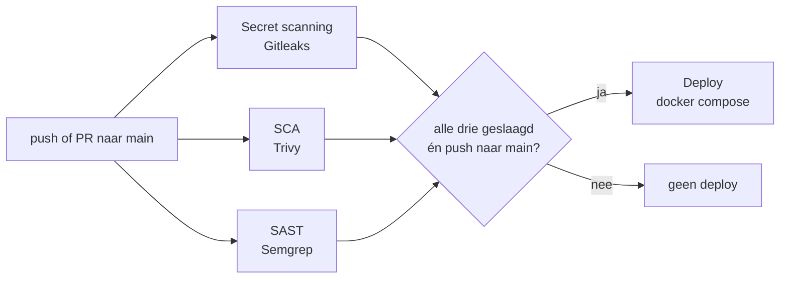

# Security pipeline

Deze pagina beschrijft de CI/CD pipeline in `.github/workflows/pipeline.yml`: welke scans er draaien, welke DSOMM-activiteit elke scan invult, wat wij als kritieke bevinding beschouwen, welke bevindingen van de ongewijzigde app we aanvaard hebben en hoe de app automatisch uitgerold wordt.

DSOMM-namen en levels komen uit DSOMM versie 5.0.2 (september 2026).

## Overzicht

| Job | Tool | Wat wordt gescand | DSOMM-activiteit | Faalt bij |
|---|---|---|---|---|
| `secret-scan` | Gitleaks 8.18.2 | volledige git-history | Test and Verification › Static depth for infrastructure › **Test for stored secrets in code** (level 1) | elk geheim dat niet in `.gitleaksignore` staat |
| `sca` | Trivy 0.74.0 | dependencies (`packages.lock.json`, …) | Test and Verification › Static depth for applications › **Software Composition Analysis (server side)** (level 2) | een HIGH of CRITICAL CVE die niet in `.trivyignore` staat |
| `sast` | Semgrep 1.178.0, ruleset `p/default` | broncode (C#, JS, Dockerfile, YAML, …) | Test and Verification › Static depth for applications › **Static analysis for important server side components** (level 3) | een ERROR of WARNING bevinding die niet in `.semgrep-baseline` staat |
| `deploy` | Docker Compose | – | Build and Deployment › Deployment › **Defined deployment process** (level 1) | – |

De manier waarop we met bevindingen omgaan vult daarnaast ook deze activiteiten in:

- Test and Verification › Consolidation › **Treatment of defects with high or critical severity** (level 1): een nieuwe kritieke bevinding blokkeert de deploy.
- Test and Verification › Consolidation › **Simple false positive treatment** (level 1): aanvaarde bevindingen staan met een reden in een baselinebestand in de repo.
- Build and Deployment › Build › **Pinning of artifacts** (level 2): actions op commit-SHA, tools op vaste versie met checksum.

## Wat is een kritieke bevinding?

Elke tool gebruikt een eigen schaal, dus we hebben per tool vastgelegd wat de pipeline laat falen.

| Tool | Kritiek (pipeline faalt) | Niet kritiek (enkel gelogd) | Waarom |
|---|---|---|---|
| Gitleaks | **elke** gevonden secret | – | Een gelekt geheim is meteen bruikbaar voor een aanvaller en blijft in de git-history staan, ook als je het later verwijdert. Gitleaks heeft geen severity; elke bevinding telt. |
| Trivy | **CRITICAL** en **HIGH** | MEDIUM, LOW (niet gescand) | HIGH bevat al ernstige problemen zoals DoS en RCE in libraries. Alleen CRITICAL zou te veel doorlaten; MEDIUM/LOW zou de pipeline blokkeren op ruis. |
| Semgrep | **ERROR** en **WARNING** | INFO | ERROR en WARNING zijn regels die op een echte kwetsbaarheid wijzen (bv. container als root, stacktrace naar de gebruiker). INFO-regels zijn audit-hints die vaak vals positief zijn (bv. `replaceAll`-sanitization in `app.js`). |

## Baseline: aanvaarde bevindingen van de eerste run

De eerste run op de ongewijzigde app vond onderstaande bevindingen. Die zitten in de aangeleverde code en worden in een latere fase van het vak opgelost. We aanvaarden ze daarom in een baselinebestand, met een korte reden boven elke regel. Alles wat **nieuw** bijkomt laat de pipeline wel falen.

| Tool | Bevinding | Baselinebestand | Reden |
|---|---|---|---|
| Gitleaks | `generic-api-key` in `app/appsettings.json:15` (Notifications:ApiKey) | `.gitleaksignore` | Bestaand in de aangeleverde app; wordt later naar GitHub Secrets/omgevingsvariabele verplaatst en geroteerd. |
| Trivy | CVE-2024-21907, Newtonsoft.Json 12.0.1 (HIGH, DoS via diep geneste JSON) | `.trivyignore` | Bestaande dependency; upgrade naar ≥ 13.0.1 gebeurt later. |
| Semgrep | `missing-user-entrypoint` in `app/Dockerfile` (container draait als root) | `.semgrep-baseline` | Bestaand; wordt later opgelost met een `USER` in de Dockerfile. |
| Semgrep | `stacktrace-disclosure` in `app/Program.cs` (`UseDeveloperExceptionPage`) | `.semgrep-baseline` | Bestaand; wordt later beperkt tot de Development-omgeving. |

Hoe precies de baseline werkt verschilt per tool:

- **Gitleaks** aanvaardt op *fingerprint* (`commit:bestand:regel:lijn`), niet op bestand. Een nieuw geheim in hetzelfde `appsettings.json` heeft een andere fingerprint en wordt dus wel gemeld.
- **Trivy** aanvaardt op CVE-ID. Een nieuwe CVE, ook in dezelfde library, wordt gemeld.
- **Semgrep** heeft geen ingebouwd baselinebestand. `.github/scripts/semgrep_gate.py` leest het JSON-rapport en vergelijkt elke bevinding met `.semgrep-baseline` op *regel + bestand*. Dezelfde regel in een ander bestand laat de pipeline wel falen. Het script drukt alle bevindingen af met `(aanvaard)` of `(NIEUW)` erbij.

### Waarom een manuele scan meer vindt dan de pipeline

Gitleaks en Trivy tonen aanvaarde bevindingen **niet** in de pipeline-log; Semgrep wel (via het gate-script). Scan je manueel zonder de ignore-bestanden, dan zie je de bevindingen uit de tabel hierboven wel. Dat is verwacht. Lokaal getest:

| | zonder baseline | met baseline |
|---|---|---|
| Gitleaks | exit 1 (faalt) | exit 0 |
| Trivy | exit 1 (faalt) | exit 0 |
| Semgrep-gate | exit 1 bij een nieuwe WARNING | exit 0 |

### Een nieuwe bevinding aanvaarden

Enkel doen als je de bevinding bekeken hebt en hem bewust aanvaardt (vals positief of gepland voor later):

1. Haal de ID uit de pipeline-log (Gitleaks: `Fingerprint`, Trivy: CVE-ID, Semgrep: rule-id + pad).
2. Voeg hem toe aan het juiste baselinebestand, met een regel `# reden: ...` erboven.
3. Commit; de reden is dan zichtbaar in de review en in de git-history.

## Automatische uitrol

De job `deploy` draait op de self-hosted runner op de server zelf en voert `docker compose up -d --build --remove-orphans` uit. Compose bouwt de image opnieuw en vervangt enkel containers die gewijzigd zijn.

De deploy draait enkel als:

- alle drie de scan-jobs geslaagd zijn (`needs: [secret-scan, sca, sast]`), **en**
- het een push naar `main` is (`if: github.event_name == 'push' && github.ref == 'refs/heads/main'`).

Een pull request doorloopt dus alle scans maar rolt nooit uit. Met `concurrency: deploy-production` lopen er nooit twee deploys tegelijk.

## Beveiliging van de pipeline zelf

| Maatregel | Hoe |
|---|---|
| Geen geheimen in de workflow | De workflow bevat geen wachtwoorden of tokens. De deploy heeft er ook geen nodig, omdat de runner op de server zelf draait. Komt er later een geheim bij (bv. SSH-sleutel), dan via GitHub Secrets: `${{ secrets.NAAM }}`. |
| Minimale rechten `GITHUB_TOKEN` | `permissions: contents: read` bovenaan de workflow: het token kan enkel code lezen. |
| Actions vastgepind op SHA | `actions/checkout@11bd71901bbe5b1630ceea73d27597364c9af683 # v4.2.2`. Een tag kan verplaatst worden, een SHA niet. |
| Tools vastgepind en gecontroleerd | Gitleaks en Trivy op vaste versie, met `sha256sum -c` tegen de checksum van de release. Semgrep op vaste versie (`semgrep==1.178.0`) in een eigen venv. |
| Geen stille fouten | Geen `\|\| true` meer: faalt een download of installatie, dan faalt de job. |
| Tools buiten de repo | Binaries komen in `$RUNNER_TEMP`, zodat ze zelf niet mee gescand worden en na de job verdwijnen. |

### Oude pipeline

`.github/workflows/pipelinenoerrors.yml` is de vorige versie van de pipeline, zonder gates. Hij staat enkel nog op `workflow_dispatch` (handmatig starten via *Actions › Run workflow*), zodat hij niet automatisch buiten de security gates om uitrolt.

## Bestanden

| Bestand | Rol |
|---|---|
| `.github/workflows/pipeline.yml` | de pipeline |
| `.github/scripts/semgrep_gate.py` | laat Semgrep falen op nieuwe ERROR/WARNING-bevindingen |
| `.gitleaksignore` | baseline Gitleaks |
| `.trivyignore` | baseline Trivy |
| `.semgrep-baseline` | baseline Semgrep |
| `.github/workflows/pipelinenoerrors.yml` | oude pipeline, enkel handmatig |

## Gekende beperkingen

- **Gitleaks vindt niet elk wachtwoord.** De standaardregels zoeken vooral tokens met een herkenbaar formaat (GitHub, AWS, API-keys). Een wachtwoord met tekens als `!`, `#`, `$` of `@` wordt vaak niet herkend, bv. `Password=...` in een connection string of `POSTGRES_PASSWORD:` in `docker-compose.yml`. Daardoor staan de bestaande databankwachtwoorden ook niet in de baseline. Oplossing: een `.gitleaks.toml` met extra wachtwoordregels.
- **Trivy downloadt zijn kwetsbaarhedendatabase** bij de eerste run naar `~/.cache/trivy` van de runner. Zonder internettoegang faalt de SCA-job (bewust, i.p.v. stil over te slaan).
- **Self-hosted runner en pull requests.** Scans van een PR draaien op de server. Bij een publieke repo kan iemand via een fork-PR code laten uitvoeren op de runner. Zet in dat geval *Settings › Actions › Fork pull request workflows* op goedkeuring vereist.
