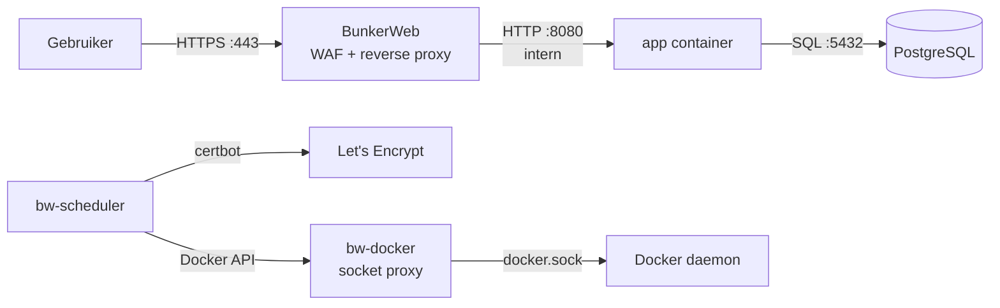

# Web Application Firewall

Deze pagina beschrijft de BunkerWeb WAF die voor de applicatie staat: wat hij doet, hoe hij geconfigureerd is, hoe het Let's Encrypt certificaat werkt en wat we getest hebben.

## Overzicht



De gebruiker bereikt de app enkel via BunkerWeb op poort 443 (HTTPS). Poort 8080 is niet meer van buitenaf bereikbaar: de app-container gebruikt `expose` in plaats van `ports`, waardoor alleen containers op hetzelfde Docker-netwerk erbij kunnen.

## Configuratie

De volledige setup staat in `docker-compose.yml` en bevat vijf containers:

| Container | Image | Rol |
|---|---|---|
| `app` | eigen build | de .NET berichtenapp, luistert intern op poort 8080 |
| `db` | postgres:17 | PostgreSQL database |
| `bunkerweb` | bunkerity/bunkerweb:1.5.11 | WAF en reverse proxy, luistert op poort 80 en 443 |
| `bw-scheduler` | bunkerity/bunkerweb-scheduler:1.5.11 | beheert BunkerWeb-configuratie, voert certbot uit voor Let's Encrypt |
| `bw-docker` | tecnativa/docker-socket-proxy:nightly | geeft de scheduler veilige read-only toegang tot de Docker socket |

### Netwerken

Drie gescheiden Docker-netwerken beperken welke containers met elkaar kunnen praten:

| Netwerk | Containers | Doel |
|---|---|---|
| `bw-services` | bunkerweb, app, db | verkeer van WAF naar app en database |
| `bw-universe` (10.20.30.0/24) | bunkerweb, bw-scheduler | intern beheer tussen WAF en scheduler |
| `bw-docker` | bw-scheduler, bw-docker | toegang tot Docker socket voor configuratie |

### BunkerWeb environment variabelen

| Variabele | Waarde | Betekenis |
|---|---|---|
| `SERVER_NAME` | g16.cyberaxel.be | het domein waarvoor BunkerWeb luistert |
| `USE_REVERSE_PROXY` | yes | BunkerWeb werkt als reverse proxy |
| `REVERSE_PROXY_URL` | / | proxy al het verkeer |
| `REVERSE_PROXY_HOST` | http://app:8080 | stuur verkeer door naar de app-container |
| `AUTO_LETS_ENCRYPT` | yes | vraag automatisch een Let's Encrypt certificaat aan |
| `API_WHITELIST_IP` | 127.0.0.0/8 10.20.30.0/24 | alleen localhost en het bw-universe netwerk mogen de BunkerWeb API aanspreken |

## Let's Encrypt

De `bw-scheduler` container voert certbot uit om een certificaat aan te vragen via de HTTP-01 challenge. Dat werkt zo:

1. De scheduler vraagt een certificaat aan bij Let's Encrypt voor `g16.cyberaxel.be`.
2. Let's Encrypt stuurt een HTTP-request naar poort 80 van dat domein om te controleren dat wij het beheren.
3. BunkerWeb beantwoordt die challenge op poort 80.
4. Bij succes wordt het certificaat opgeslagen in het `bw-data` volume en automatisch vernieuwd.

Voorwaarden:

- Een AAAA DNS-record in Cloudflare (DNS only, niet geproxied) dat `g16.cyberaxel.be` naar `2a02:1810:a531:7602::116` wijst.
- Poort 80 open voor de HTTP-01 challenge.

We hebben eerst getest met `USE_LETS_ENCRYPT_STAGING=yes` om de rate limits van Let's Encrypt niet te raken. Na succesvolle test hebben we die variabele verwijderd en het `bw-data` volume verwijderd om een productiecertificaat aan te vragen.

Het huidige certificaat:

- CN: g16.cyberaxel.be
- Issuer: Let's Encrypt (R11)
- TLS 1.3 (TLS_AES_256_GCM_SHA384)
- Geldig tot 15 januari 2027

## Waarom de scheduler nodig is

BunkerWeb 1.5+ heeft de `bw-scheduler` container nodig om certbot uit te voeren. Zonder de scheduler logt BunkerWeb `let's encrypt is not used`, ook als `AUTO_LETS_ENCRYPT=yes` staat. De scheduler gebruikt de Docker socket (via `bw-docker`) om de BunkerWeb-container te vinden en te herconfigureren na het aanvragen van een certificaat.

## Poort 8080 dicht

In de oorspronkelijke `docker-compose.yml` (bewaard als `docker-composeoriginal.yml`) stond:

```yaml
ports:
  - "8080:8080"
```

Dit is vervangen door:

```yaml
expose:
  - "8080"
```

`expose` maakt de poort alleen beschikbaar binnen het Docker-netwerk. Controle met `ss -tlnp | grep 8080` bevestigt dat poort 8080 niet meer luistert op de host.

## Aanvaldemonstratie

### Aanval 1: XSS via script-tag

```
curl -k "https://localhost/<script>alert('xss')</script>"
```

Resultaat: **403 Forbidden**. BunkerWeb herkent de `<script>`-tag als een XSS-aanval en blokkeert het verzoek.

### Dezelfde aanval in andere vormen

| Variant | Payload | Resultaat |
|---|---|---|
| URL-encoded | `%3Cscript%3Ealert(%27xss%27)%3C%2Fscript%3E` | 403 |
| Case-mixing | `%3CScRiPt%3Ealert(1)%3C%2FScRiPt%3E` | 403 |
| img-tag met onerror | `%3Cimg%20src%3Dx%20onerror%3Dalert(1)%3E` | 403 |
| svg-tag met onload | `%3Csvg%20onload%3Dalert(1)%3E` | 403 |
| javascript: protocol | `?url=javascript:alert(1)` | 403 |

### Aanval 2: SQL injection

```
curl -k "https://localhost/?id=1%27%20OR%201%3D1--"
```

Resultaat: **403 Forbidden**.

| Variant | Payload | Resultaat |
|---|---|---|
| Dubbele encoding | `1%2527%2520OR%25201%253D1--` | 403 |

### Normale request (controle)

```
curl -k "https://localhost/" -o /dev/null -w "%{http_code}"
```

Resultaat: **200 OK**. De app werkt normaal voor legitiem verkeer.

### Wat zegt dit over een WAF?

BunkerWeb blokkeert alle geteste aanvalsvormen, inclusief URL-encoded, dubbel encoded en alternatieve HTML-tags. Een WAF is een effectieve extra verdedigingslaag (defense-in-depth) die bekende aanvalspatronen herkent en blokkeert voordat ze de applicatie bereiken.

Maar een WAF is geen vervanging voor veilige code. Een WAF werkt met patroonherkenning (signatures en regels) en kan omzeild worden door voldoende creatieve of onbekende aanvallen. Daarom blijft het nodig om de kwetsbaarheden in de applicatie zelf op te lossen, zoals de SQL injection en XSS die de AI agent en SAST gevonden hebben.
